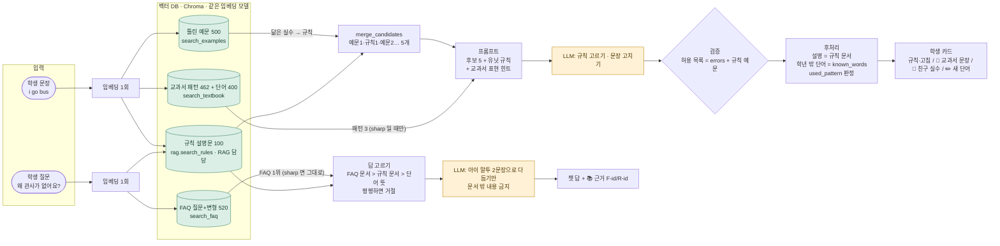

# 검색 함수 계약 — `backend/textbook.py` 검색 함수와 /fix · /ask 가 바뀌는 그림

작성 2026-09-14 · 팀장 · 대상: 검증 세션(tutor.py), TTS 담당(ask.py), RAG 담당(복귀 뒤 indexing/rag 로 합치기)
배경: 교수님 지적("규칙은 모델이 이미 안다, 설명은 모델 말") 대응. RAG 담당이 오늘 못 하므로 **함수 이름·반환 형식을 먼저 고정**하고 임시 구현까지 넣어 둔다. RAG 담당은 나중에 속(색인 방식)만 바꾸면 되고, 이름·형식이 같으면 tutor·ask 는 안 바뀐다.

## 0. 한 장 그림 — /fix 와 /ask 가 어떻게 바뀌나



두 API 의 공통 원칙: **검색이 후보를 좁히고, 답의 내용은 우리 문서에서 나오고, LLM 은 고르기·고치기·말투 다듬기만.** 지금(v1)과 다른 점은 검색 대상이 규칙 설명문 하나에서 넷으로 늘고, 답 내용이 문서에서 나온다는 것.

/ask 는 **검색이 먼저**: FAQ 와 교과서(패턴·단어)를 둘 다 검색해(같은 유닛 우선) 그 안에서 LLM 이 답과 예문을 짓고, 둘 다 뚜렷한 게 없으면 "이 유닛 내용이 아니에요"로 거절한다. 유닛 자료를 통째로 넣지 않는다 (2-1절).

## 1. 함수 계약 (이름·반환 형식 고정)

모듈: `backend/textbook.py` (RAG 담당이 나중에 `indexing.py`/`rag.py` 로 옮겨도 **이름·시그니처·반환 키는 유지**).
공통: 임베딩은 `embedding.embed_query/embed_documents` (.env 의 EMBEDDING_BACKEND) · `qvec` 를 주면 재임베딩 안 함 · 색인 없거나 실패하면 예외 대신 빈 결과 · 점수는 코사인 0~1 · 절대 문턱 없음(호출자가 `sharp()` 로 판단).

```python
search_textbook(text, level=3, k_pattern=3, k_word=5, min_score=0.0, qvec=None) -> dict
# {"patterns": [{id, text, meaning, tip, rule_id, unit, level, score}], "words": [{id, word, meaning, example, unit, level, score}], "query_ms", "error"}
# 학년(level) 이하만. /fix "교과서 표현" 힌트 · 화면 📖 타일

search_examples(text, level=None, k=5, qvec=None) -> list[dict]
# [{id: "R-09", type, text, unit, score, example_id: "E-0035", example: "I have many rice.", fix, correct}]
# 틀린 예문(errors 400 + 규칙 wrong_example 100)으로 찾은 규칙 후보. rag.search_rules 와 같은 키(id·type·text·unit·score) + 예문 정보. /fix 후보 · 화면 🙋 타일

merge_candidates(by_examples, by_rules, k=5) -> list[dict]
# 예문1·규칙1·예문2·규칙2… 번갈아, 같은 규칙 한 번, 항목마다 from: "examples"|"rules". /fix 프롬프트 후보 5개

search_faq(question, k=3, rule_id=None, qvec=None) -> list[dict]
# [{id: "F-012", question, answer, rule_ids: [...], unit, example, score, matched: "닮은 질문 변형"}]
# FAQ 질문+변형을 "질문 — 답" 으로 색인. rule_id(직전 규칙)가 있으면 관련 FAQ +0.03. /ask 의 단어 겹침 매칭 자리

search_rule_aliases(question, k=3, qvec=None) -> list[dict]          # 2026-09-14 저녁 추가
# [{id: "R-31", type, short, text, examples, unit, score, matched: "닮은 별칭"}]
# 규칙마다 이름(type)·요약(short)·"X가 뭐예요?"·"X 뜻이 뭐예요?"·설명문 첫 문장 5개를 별칭으로 색인(500건, 컬렉션 rulealias_*).
# "과거시제가 뭐예요?" 같은 문법 용어 질문 → 규칙 문서. 답은 여기서 안 만들고 text·examples 로 LLM 이 짓는다 (FAQ 줄을 늘리는 것과 다른 점).

similar_examples(text, rule_id, k=3, qvec=None, exclude_text="") -> list[dict]   # 같은 규칙의 닮은 틀린 예문 (화면 🙋 타일, 원문과 같은 문장 제외)

lookup_word(question, level=6) -> list[dict]                          # 2026-09-15 추가 · 임베딩 없음 (키워드 검색)
# [{id, word, meaning, example, unit, level, score=1.0}] — search_textbook 의 words 항목과 같은 모양
# 단어장(words.csv) 표 조회: 영어 낱말 → 뜻 ("bus 가 뭐야?" → w-0282), 한국어 뜻 → 영어 ("형이 영어로 뭐야?" → w-0024 brother). -s/-es/-ing/-ed 는 떼고 다시 찾음.
# 확인: python -m backend.textbook --word "형이 영어로 뭐야?" --level 4 . words 임베딩 400건은 이걸로 대체 예정(그때 textbook 색인은 patterns 만).

known_words(level) -> set[str]      # 학년 이하 교과서에 나온 말 = 단어장 표제어 + 단어장 예문·패턴 문장의 낱말 (소문자). 고친 문장의 교과서 밖 단어 후검사
sharp(scores, gap=0.06, top=0.85) -> bool   # 1위 ≥ top 이고 1위−5위 ≥ gap. 영어 문장 대 예문에서 잰 기준 — 한국어 질문에는 안 맞음(2-2절)
faq_hit(scores, top=0.85) -> bool           # FAQ 는 분포가 늘 촘촘해 절대 점수로
rule_hit(scores, top=0.86) -> bool          # 규칙 별칭도 절대 점수로 (2-2절 실측)
```

색인 명령: `python -m backend.textbook --rebuild` (넷 다) 또는 `--rebuild-textbook | --rebuild-examples | --rebuild-faq | --rebuild-rulealias`. 확인: `--search "…"`, `--examples "…"`, `--faq "…"`, `--rule "…"`.
manifest: `data/chroma/textbook_manifest.json` · `examples_manifest.json` · `faq_manifest.json` · `rulealias_manifest.json`. 골든 데이터가 바뀌면 다시 만든다.
메모리가 모자란 PC(빈 메모리 3GB 미만)에서는 모델을 읽다 MemoryError 가 난다 → `HF_ENABLE_PARALLEL_LOADING=false` 로, 평가는 한 번에 하나만.

## 2. 실측 (2026-09-14, 로컬 e5-base)

| 검색 | 시험 | 결과 |
|---|---|---|
| 규칙 찾기 — 설명문만 (지금 서비스) | 시험지 오류 300문장 | hit@1 55% · hit@3 78% · hit@5 85% |
| 규칙 찾기 — 틀린 예문 (`search_examples`) | 같음 | hit@1 77% · hit@3 90% · hit@5 93% |
| 규칙 찾기 — 합침 (`merge_candidates`) | 같음 | hit@1 77% · **hit@3 91% · hit@5 95%** |
| FAQ — 질문만 색인 | FAQ 130개, 변형 1개씩 홀드아웃 | hit@1 45% · hit@3 63% |
| FAQ — "질문 — 답" 색인 (`search_faq`, 채택) | 같음 | hit@1 59% · **hit@3 78%** |
| 교과서 패턴 (`search_textbook`) | 예문 | "I have many rice." → "I have much rice." 0.909 · 엉뚱한 문장은 최고 0.84, 분포 평평 |

| 규칙 찾기 — 합침, **정비한 데이터**(패턴 477·errors 122줄 재작성, 9/14 저녁) | 같음 | hit@1 76% · hit@3 91% · hit@5 94% (변화 없음 = 데이터 정비가 검색을 해치지 않음) |
| 규칙 별칭 (`search_rule_aliases`) | 문법 용어 질문 12개 | 1위 정답 11/12, 점수 0.864~0.927. 용어 아닌 질문 11개는 0.79~0.845 → **`rule_hit` 0.86** 으로 갈림 |

주의: 시험지(eval v2.1)가 errors 행에서 파생된 문장이라 예문 검색이 유리하게 나왔을 수 있음. 시험 문장 19개는 errors 의 error 문장과 완전히 같음(점수 부풀림) → 데이터팀에 교체 요청.

## 2-1. /ask — 검색이 먼저, 없으면 "이 유닛 내용이 아니에요" (2026-09-14 팀장 결정)

원칙: **답의 재료는 검색으로만 가져온다.** 유닛 자료를 통째로 넣지 않는다. FAQ 와 교과서(패턴·단어)를 둘 다 검색해서 그 안에서 답을 짓고, 둘 다 뚜렷한 게 없으면 "그건 이 유닛에서 배우는 내용이 아니에요 — 선생님께 물어볼까?" 로 거절한다. 대화 기억·되묻기·이어가기(지금 ask.py 엔진)는 그대로.

**색인은 유닛별이 아니다.** FAQ 130·패턴 462·단어 400·규칙 100 전부가 한 색인에 들어 있고 unit 은 메타데이터일 뿐이다. **검색을 유닛으로 잘라내면 안 된다** — "can 뒤에 s 써도 돼?" 는 Unit04 의 FAQ(F-04)·규칙(R-07)인데 Unit01 화면에서도 답해야 한다(9/14 TTS 담당 테스트에서 답이 없던 원인). 유닛은 가산점과 안내 문구에만 쓴다.

검색 순서 (질문 임베딩 1회) — 9/14 저녁 실측(2-2절)으로 0·2·2b·3 을 고침:
0. **의도 먼저 가르기(검색 아님, 코드).** 인사·감사·감정("안녕", "고마워", "피곤해")은 고정 문구로. "다른 예문/다시/왜요" 같은 이어가기는 직전 규칙(rule_id)의 문서+예문으로. 지식 질문만 아래로. (짧고 영어 낱말이 없을 때만; "안녕이 영어로 뭐야"는 지식 질문)
1. `search_faq(question, k=3, rule_id=직전 규칙)` — FAQ 질문+변형+답 (영어 낱말이 그대로 있으면 가산). **`faq_hit(scores)` = 1위 ≥ 0.85 면 정답 있음** (FAQ 는 질문 형식이 비슷해 분포가 늘 촘촘하므로 `sharp` 대신 절대 점수).
2. `search_rule_aliases(question, k=3)` — 문법 용어 질문("과거시제가 뭐예요?"). **`rule_hit` = 1위 ≥ 0.86** 이면 그 규칙 문서(text·examples)가 답 재료. 한국어 질문으로 `rag.search_rules`(설명문 본문) 를 직접 돌리는 건 믿지 않는다(9/14: "can" 질문에 R-15 will, "관사가 뭐예요"에 R-23 by+교통수단이 1위). 별칭 색인은 이름·요약이 질문과 같은 말이라 맞는다.
2b. `lookup_word(question, level=ctx.level)` — 단어장 표 조회(임베딩 없음). "형이 영어로 뭐야" → w-0024 brother, "bus 가 뭐야" → w-0282. 결과가 있으면 그 행(word·meaning·example)으로 답. 영어 → 뜻 기존 `_word_match` 를 이걸로 대체. 주의: "I like pizza 맞아?" 처럼 영어 문장이 든 '맞나요' 질문은 0번(의도)에서 먼저 /fix 판정 경로로 보내야 pizza 단어 답이 안 나간다.
3. `search_textbook(question, level=ctx.level, k_pattern=3, k_word=3)` — **`sharp` 는 쓰지 않는다**(한국어 질문에서 1위−5위 격차가 0.01~0.04 라 한 번도 안 통과, 2-2절). 1위 ≥ 0.80 이면 상위 3개 + **지금 유닛의 패턴 5·단어 5** 를 자료로 LLM 이 답. 답이 자료와 안 겹치면 버리고 1위 자료로 답(검증). 거절은 1위 < 0.78 이거나 LLM 이 offtopic 일 때만.
4. 위에 아무것도 없으면 거절: "그건 우리 교과서에서 배우는 내용이 아니에요 — 선생님께 물어볼까?". 답이 다른 유닛 것이면 "Unit 4 에서 배우는 내용이에요" 한 줄을 앞에. FAQ 가 문턱 미달일 땐 그 FAQ 의 rule_ids 를 규칙 문서로 붙이지 않는다(2 가 대신함).

LLM 이 받는 것: 위에서 찾은 것들 + 대화 기억 + (입구별 상태) 뿐. 예문은 찾아온 패턴에서만, 단어 뜻은 찾아온 단어에서만, 근거 id(F/p/w/R) 표시.

| 입구 | 대화 상태로 같이 넣는 것 (검색 아님) | 추천 칩 | 예 |
|---|---|---|---|
| 🙋 표현 익히기 | unit, level | 유닛 FAQ 2개 | "bus 가 뭐예요" → 단어 검색 w-0282 / "학교 가는 거 어떻게 말해요" → 패턴 검색 p-0282 / "점심 뭐 먹지" → 거절 |
| 🙋 고쳐줘 화면, 고쳐줘 **전** | unit + `context.text`(입력·들린 문장, 있으면) — /fix 응답은 아직 없음 | "이 문장 맞아요?"(문장 있을 때) · "미션 어떻게 말해요?" | "이거 맞아" → 지금처럼 /fix 경로로 판정 / "미션 어떻게 말해요" → 미션 문장으로 패턴 검색 / 나머지는 표현 익히기와 같음 |
| 더 물어보기 (고쳐줘 직후) | **방금 고친 결과**(원문·고친 문장·규칙·닮은 실수·교과서 문장 = /fix 응답) | /fix 의 suggested_questions | "왜 went 예요" → FAQ + 규칙 문서 / "다른 예문" → 그 규칙 패턴 검색 / "그거 다시" → 직전 턴 |
| 🙋 오답노트 | **오답노트 요약**(규칙별 횟수·최근 내 문장) + 펼친 규칙 id | "뭘 자주 틀려요?" · "왜 자꾸 틀려요?" · "비슷한 문제 더" | "왜 틀렸어" → 규칙 문서 검색 + 내 문장 대조 / "문제 더" → `search_examples` 로 같은 규칙 예문 |

거절 문구: "그건 우리 교과서에서 배우는 내용이 아니에요. 선생님께 물어볼까요?" (교과서 전체 기준). 다른 유닛의 답이면 거절이 아니라 "Unit 4 에서 배우는 내용이에요" 를 앞에 붙여 답한다 — 학생이 "지금 배우는 것"과 "나중에 배우는 것"을 구분하게.

측정: FAQ 홀드아웃(변형 1개씩) hit@3 + "예문 보여줘" 류 질문의 예문이 교과서 패턴 id 인지 + 엉뚱한 질문 20개 거절률 + 인사말 20개 응답률.

**어디까지가 RAG 인가 (9/14 저녁 팀장 질문).** FAQ 답을 그대로 돌려주는 경로는 검색만 있고 생성이 없는 FAQ 봇이다. 빠른 길로만 두고 **FAQ 줄을 늘려 문제를 풀지 않는다.** 새 질문 유형이 안 잡힐 때 물을 것은 "FAQ 에 뭘 추가하지"가 아니라 "어느 문서에 답이 있는데 검색이 왜 못 찾았지"다. 지식은 rules·patterns·words 문서에 두고, 찾는 열쇠(별칭·키워드 조회·하이브리드)를 늘리고, 답은 LLM 이 문서로 짓는다. 규칙 별칭 색인이 그 예(문서는 R-31 하나, 별칭만 5개).

## 2-2. 9/14 저녁 실측 — ask.py 상태와 TTS 담당 수정 목록

ask.py 상태(커밋 0c9bec5): `_retrieval_answer`(search_faq+faq_hit → search_textbook+sharp → 거절, 답 검증 포함)와 `_hybrid_answer`(오늘 만든 예외 처리 뒤 검색으로)가 만들어졌지만 **`/ask` 는 아직 옛 `_answer`(FAQ 130개 통째로 프롬프트)를 부른다** — 화면이 안 바뀐 이유.

채팅형 질문 12개 실측 (FAQ 1위 / 패턴 1위·격차 / 단어 1위):

| 질문 | FAQ | 패턴 | 격차 | 단어 | 지금 결과 |
|---|---|---|---|---|---|
| 학교 가는 거 영어로 어떻게 말해? | 0.875 ✓ | 0.808 | 0.043 | 0.831 | FAQ 답 |
| bus 가 무슨 뜻이야? | 0.881 ✓ | 0.817 | 0.079 | 0.804 | FAQ 답 |
| 형이 영어로 뭐야? | 0.852 ✓ | 0.776 | 0.037 | 0.789 | FAQ 답 |
| can 뒤에 s 붙여도 돼? | 0.906 ✓ | 0.762 | 0.017 | 0.773 | FAQ 답 |
| 다른 예문 보여줘 | 0.857 ✓ | 0.802 | 0.024 | 0.815 | FAQ 답 (오답 — 대화 지시문) |
| 안녕! / 고마워 / 나 오늘 피곤해 | 0.79~0.85 | 0.77~0.83 | ≤0.016 | 0.79~0.83 | **거절** (인사·감정인데) |
| 왜 went 야? | 0.822 | 0.773 | 0.011 | 0.784 | **거절** (직전 대화 필요) |
| 과거시제가 뭐에요 | 0.827 | — | — | — | **거절** → 규칙 별칭 R-31 0.927 |
| 점심 뭐 먹지? | 0.804 | 0.783 | 0.032 | 0.790 | 거절 (맞음) |

읽는 법: FAQ 는 잘 걸린다(질문+답 색인). 패턴·단어의 `sharp` 는 한국어 질문에서 한 번도 안 통과한다(격차 0.01~0.04). 점수 절대값으로는 "형이 영어로 뭐야"(단어 0.789)와 "점심 뭐 먹지"(0.790)를 못 가른다 → 문턱만 낮춰서는 안 되고 0·2·2b 가 필요하다.

TTS 담당 수정 목록 (ask.py, 우선순위 순):
1. **연결** — `/ask` 가 `_hybrid_answer` 를 부르게. 76문항 전/후 표 공유.
2. **규칙 별칭** — `_retrieval_answer` 의 FAQ 다음에 `search_rule_aliases(question, qvec=qvec)` → `rule_hit` 이면 그 규칙 문서(text·examples)로 LLM 이 답.
3. **의도 가르기** — 위 0번. 지금은 "안녕"이 거절되고 "다른 예문 보여줘"가 FAQ 에 잘못 걸린다.
4. **단어장 조회** — `textbook.lookup_word(question, level=ctx.level)` 호출(9/15 만들어 둠, 함수 하나). FAQ 다음·임베딩 검색 전에. 결과가 있으면 그 단어 행으로 답하고 기존 `_word_match`(영어 낱말 겹침)는 제거. 확인 명령 `python -m backend.textbook --word "형이 영어로 뭐야?"`.
5. **학년** — `AskContext` 에 `level` 추가, `search_textbook(level=ctx.level)`. 지금 3 고정이라 4~6학년 자료가 빠짐. 화면은 이미 보냄(common.js, 9/14).
6. **패턴·단어 판정 완화** — 위 3번 (sharp 대신 0.80/0.78 + 현재 유닛 자료 10개).
7. 다른 유닛 자료로 답할 땐 "Unit N 에서 배우는 내용이에요" 앞에.
8. FAQ 문턱 미달이면 그 FAQ 의 rule_ids 를 규칙 문서로 붙이지 않기.
9. 마무리 — 옛 폴백 삭제, `_hybrid_answer` 의 복사 코드 정리, 검색 프롬프트의 "3~4학년"을 학년 변수로.

색인: `git pull` 뒤 `python -m backend.textbook --rebuild-rulealias` 한 번 (다른 셋은 데이터가 바뀌었으면 같이).

## 3. 누가 무엇을 (RAG 담당 없이 진행)

| 담당 | 파일 | 할 일 |
|---|---|---|
| 검증 세션 | tutor.py · prompts/fix_fallback.txt · tests/eval_fix.py | ① `search_examples` + `rag.search_rules` → `merge_candidates` 로 후보 5개 ② `search_textbook` 결과가 `sharp` 면 "교과서 표현" 블록 ③ 고친 문장 단어 ∉ `known_words(level)` → `outside_words` (표시만) ④ 응답에 `textbook{patterns, words, used_pattern, query_ms}`, `peer_example{text,target,fix,error_id}`(예문 1위), `outside_words` ⑤ 허용 목록에 규칙 본문·예문 단어 ⑥ `--no-textbook` 이면 ② 생략 |
| TTS 담당 | ask.py | 2-2절 수정 목록 1~9 (연결 → 규칙 별칭 → 의도 가르기 → 단어장 역방향 → 학년 → 판정 완화 → 유닛 안내 → 규칙 문서 조건 → 정리). 검색 경로 자체(`_retrieval_answer`)는 이미 있음 |
| 팀장 | textbook.py(rulealias) · tests/eval_ask.py · 관리자 ④ 패널 | 규칙 별칭 색인(완료 9/14), 채팅 시험지(76문항 + 엉뚱한 20 + 인사 20) 채점 스크립트, 관리자에 붙이기 |
| RAG 담당(복귀 뒤) | indexing.py · rag.py | 세 색인을 자기 구조로 흡수(이름 유지), `sharp` 기준 실측, `/rag/textbook` 확인 API |
| 데이터팀 | eval.csv · errors.jsonl | errors 무관 시험 문장 50, 틀린 예문 다양화, units.csv 4~6학년 행 |

## 4. 지금 화면이 이미 읽는 이름 (frontend/js/tutor.js)

`r.textbook.patterns[0]` · `r.textbook.used_pattern` · `r.peer_example{text,target}` · `r.outside_words` · `r.explanation{short,text,examples}` · `r.grounded`.
서버가 아직 안 주는 필드는 화면이 관리자 API(/admin/textbook)·/drill 로 임시로 채우고 있으니, 서버가 주기 시작하면 그걸 우선 쓴다 (화면 수정 불필요).
