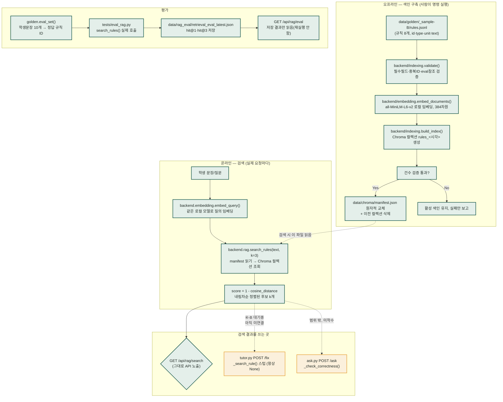

# RAG 관련 추가·수정 코드 목록 + 파이프라인

작성일: 2026-09-09 · 실행 단위 ①~③(완료) + ④-A(인계 완료) 기준

---

## 1. 파이프라인 다이어그램

### 단계별 정리

| 단계 | 실제 구현 | 상태 |
|---|---|---|
| ① 데이터 검증 | `indexing.validate()` | ✅ 실제 동작 |
| ② 임베딩 | `embedding.embed_documents/embed_query` (all-MiniLM-L6-v2, 로컬) | ✅ 실제 동작 |
| ③ 색인 | `indexing.build_index()` → Chroma `data/chroma/` | ✅ 실제 동작 (`--rebuild`) |
| ④ 검색 | `rag.search_rules()` / `GET /rag/search` | ✅ 실제 동작 |
| ⑤ 검색 평가 | `tests/eval_rag.py` / `GET /rag/eval` | ✅ 실제 동작 (hit@3 75%, 목표 미달이지만 사용자 승인 하 진행 중) |
| ⑥ 생성 연결(`/fix`) | `tutor.py._search_rule()` | ⏳ **아직 스텁** — 팀장이 ④-B로 연결해야 함, 그때까지 항상 fallback |
| ⑦ 챗 연결(`/ask`) | `ask.py._check_correctness()` | ⏳ 이번 범위 밖, 정보만 인계됨 |

**핵심 한계**: ④→⑥ 화살표(검색 결과 → `/fix` 실제 사용)가 아직 안 이어져 있습니다. 검색 자체는 완성돼 실제로 잘 동작하지만, 튜터 화면에서 문장을 고쳐달라고 하면 아직도 "규칙 8개 전부 Gemini에 던지기" 방식(`mode="fallback"`)으로만 응답합니다. [팀장-인계문서.md](팀장-인계문서.md)를 팀장이 반영해야 이 화살표가 실제로 연결됩니다.

---

## 2. 신규 코드 파일 (4개, 총 545줄)

| 파일 | 줄수 | 주요 함수/구성 | 역할 |
|---|---|---|---|
| **`backend/embedding.py`** | 40 | `embed_documents(texts)`, `embed_query(text)`, `_get_ef()` | Chroma 기본 로컬 임베딩(all-MiniLM-L6-v2, 384차원) 래퍼 |
| **`backend/indexing.py`** | 267 | `validate()` · `_print_report()` (①) `build_index()` · `load_manifest()` · `_chroma_client()` · `_data_hash()` (②) `check_embedding()` (Gemini 비교용, 미채택) `main()` — CLI `--validate-only`/`--rebuild`/`--check-embedding` `class IndexUnavailableError` | 데이터 검증 + Chroma 색인 생성·관리 |
| **`backend/rag.py`** — 기존 파일 수정 | 95 | `search_rules(text, k=3)` (신규) `GET /search` (신규 구현, 기존 스텁 교체) `POST /check`, `GET /eval` (`/eval`만 실제 구현) | 검색·평가 API |
| **`tests/eval_rag.py`** | 143 | `run_retrieval_eval()`, `_print_summary()`, `main()` — CLI `--retrieval-only` | 검색 평가 실행기 (hit@1·hit@3) |

### 기존 파일 중 수정한 것
- **`backend/rag.py`** — 유일하게 기존 코드를 수정. `/search`(스텁→실구현), `/eval`(스텁→저장결과 읽기)만 바꿨고 `/check`는 그대로 둠(범위 밖)

### 코드 리뷰 (2026-09-09, `/code-review ultra` 로컬 실행)

10건 발견, 우선순위 상위 3건 수정 완료 · 나머지 7건 미수정.

| # | 내용 | 상태 |
|---|---|---|
| 1 | `--validate-only`가 rules.jsonl/errors.jsonl의 잘못된 JSON에 크래시함 | ✅ 수정 — 이제 파일명과 함께 오류로 보고하고 정상 종료 |
| 2 | `search_rules()`가 컬렉션 접근 실패만 `IndexUnavailableError`로 정규화, 임베딩·질의 실패는 원본 예외 그대로 샘 | ✅ 수정 — 검색 과정 전체를 하나의 예외로 정규화(→ 팀장 인계문서·work order 관련 문구도 갱신) |
| 3 | `build_index()`에서 `col.add()` 실패 시 고아 Chroma 컬렉션이 정리 안 됨 | ✅ 수정 — 실패 시 즉시 삭제 |
| 4 | `eval_rag.py`의 결과 파일 쓰기가 비원자적이라 `/rag/eval` 조회와 경합 가능 | ⬜ 미수정 |
| 5 | `rules.jsonl`에 빈 줄이 있으면 오류 보고의 줄 번호가 틀어짐 | ⬜ 미수정 |
| 6 | `search_rules()`가 매 요청마다 새 Chroma 클라이언트 생성(비효율) | ⬜ 미수정 |
| 7 | `build_index()`가 rules.jsonl을 두 번 읽음(비효율) | ⬜ 미수정 |
| 8 | `embedding._get_ef()` 싱글턴이 동시 요청에 스레드 안전하지 않음 | ⬜ 미수정 (경미) |
| 9 | 동시에 두 `--rebuild`를 돌리면 서로의 새 컬렉션을 지울 수 있음 | ⬜ 미수정 (희귀 상황) |
| 10 | `--rebuild --check-embedding` 동시 지정 시 `--rebuild`가 조용히 무시됨 | ⬜ 미수정 (경미) |

세 건 모두 실패 상황을 실제로 재현해 수정 확인, `--validate-only`/`--rebuild`/실제 검색/`eval_rag` 회귀 없음 확인. 커밋 `c026273`.

### 건드리지 않은 것 (명시적 제외)
`backend/tutor.py`, `backend/ask.py`, `frontend/**`(HTML/JS/CSS), `backend/config.py`, `backend/golden.py`, `backend/llm.py` — 전부 읽기만 하고 수정 안 함

## 3. 코드가 만드는 산출물 (Git 제외, 실행해야 생김)

| 경로 | 만드는 명령 |
|---|---|
| `data/chroma/manifest.json` + `rules_<timestamp>` 컬렉션 | `python -m backend.indexing --rebuild` |
| `data/rag_eval/retrieval_eval_latest.json` + `retrieval_eval_<시각>.json` | `python -m tests.eval_rag --retrieval-only` |

## 4. 관련 문서

| 파일 | 성격 |
|---|---|
| `docs/RAG_0909/rag-implementation-work-order_v0.2.md` | 기준 작업지시서(검토본) — ①~④ 진행표 |
| `docs/RAG_0909/rag-step-execution-prompts.md` | ①~④ 상세 실행·검증 기록 (제일 긴 원본 로그) |
| `docs/RAG_0909/팀장-인계문서.md` | 팀장용 인계 문서(전달 메시지 + 상세 내용) |
| `docs/RAG_0909/TTS담당-인계문서.md` | TTS담당용 인계 문서(전달 메시지 + 상세 내용) |
| `docs/0908/룰스초안-검토메모.md`, `데이터팀-전달메시지.md` | 30개 규칙 초안 검토 결과 + 발송용 메시지 |

커밋·푸시는 하지 않았습니다 — 전부 워킹 디렉토리에만 있습니다.
