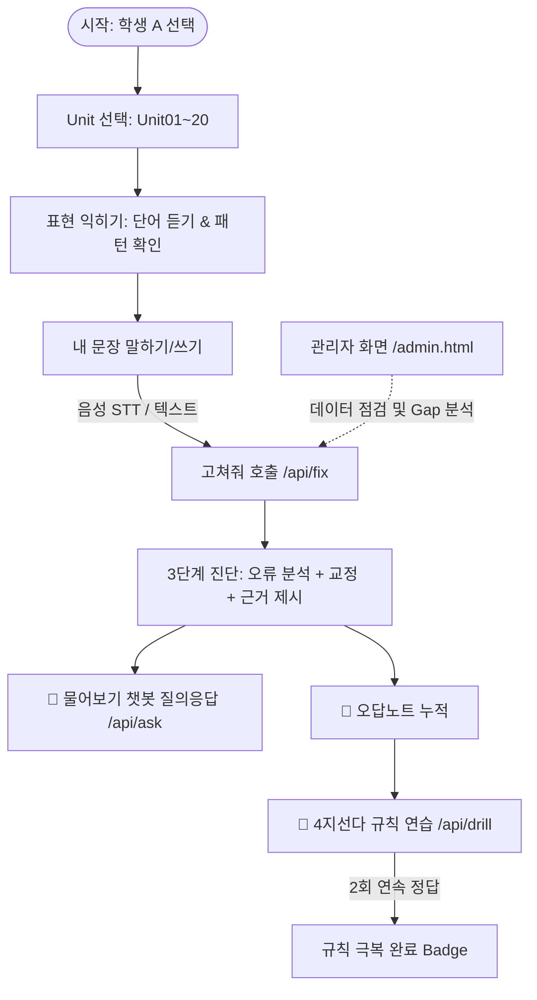

# [PRD] 초등 영어학습 · RAG 맞춤 복습 튜터 (현행 상태 파악 및 점검용)

> **문서 상태**: 현행 구현 반영판 (As-Built & Status Inspection)  
> **기준 일자**: 2026-09-16  
> **관련 문서**: `docs/plan-B/PRD-as-built.md` · `docs/2026.09.14 검색 함수 계약 (textbook·examples·faq).md` · `docs/2026.09.15 RAG 담당 요청 (textbook.py 합치기 · 할 일).md`

---

## 1. 프로젝트 개요 (Executive Summary)

### 1.1 제품 정의
초등학생이 음성(🎙) 또는 텍스트(⌨)로 입력한 영어 문장을 분석하여, **자체 구축한 문법 규칙 및 교과서 데이터(RAG)에서 관련 근거를 검색**하고, LLM이 **근거 기반으로 문장을 교정하고 초등 눈높이 설명**을 제공하는 맞춤형 AI 튜터 시스템입니다.

### 1.2 핵심 문제 정의 및 RAG의 역할
- **초등 영어의 특성**: 문법적 정답(예: *go의 과거형은 went*)은 이미 닫혀 있습니다. 하지만 **학생의 입력에는 어떤 규칙을 위반했는지에 대한 라벨이 없습니다.**
- **RAG의 핵심 역할 ("깔때기 & 목줄")**:
  - **깔때기 (Funnel)**: 라벨 없는 다양한 학생 오류 문장/자유 질문을 정밀한 교과서·문법 규칙 조각으로 좁혀줍니다.
  - **목줄 (Leash)**: LLM이 환각을 일으켜 검증되지 않은 문법이나 초등 교육과정을 벗어난 단어를 생성하지 못하도록 검색된 조각 내로 출력을 통제합니다.
- **RAG v2 진화 (2026-09-14 반영)**: 규칙 설명문 검색(v1)에 더해 **틀린 예문(500건), 교과서 패턴(462건), 어휘(400건), FAQ(520건), 규칙 별칭(500건)**을 다중 벡터 컬렉션으로 분리 색인하여 검색 정확도(hit@3 78% → 91%)와 설명의 신뢰도를 극대화했습니다.

---

## 2. 타깃 사용자 및 서비스 범위 (Target & Scope)

| 구분 | 대상 | 특징 및 역할 |
|---|---|---|
| **학생** | 초등 6학년 (Level 3 기준) | 별도 로그인 없이 간편 프로필(학생 A/B) 선택 후 학습, 음성/텍스트 입출력 |
| **관리자/교사** | 운영자 및 튜터 코치 | 골든 데이터 및 색인 상태 점검, RAG 검색 정확도 모니터링, 취약 규칙 및 미매칭(Gap) 분석 |
| **데이터팀** | 교육과정 콘텐츠 제작자 | 문법 규칙, 교과서 패턴/단어, 오류 예문, FAQ 데이터셋 지속 개선 및 보강 |

- **범위 내 (In-Scope)**:
  - Unit 기반 표현 학습 및 듣기 (Piper TTS)
  - 학생 자유 발화 문장 분석 및 교정 (`/fix`)
  - 다중 컬렉션 RAG 기반 근거 검색 (Chroma + Multilingual-E5 / Gemini 임베딩)
  - 2단계 검증(서버 규칙 허용 목록 + LLM Second Opinion)
  - 맥락 인지형 Q&A 챗봇 (`/ask`)
  - 개인화 오답노트 (`/notebook`) 및 4지선다 규칙 연습 (`/drill`)
  - Whisper 음성 인식(STT) 및 한/영 하이브리드 발화 처리
- **범위 밖 (Out-of-Scope)**:
  - 정식 사용자 인증 및 계정 관리 (현재 A/B 로컬 세션)
  - 정량적 발음 점수(Phoneme) 노출 (단순 텍스트 일치율/파형 비교만 제공)
  - 외부 상용 LMS 연동 및 클라우드 결제

---

## 3. 핵심 사용자 여정 (User Journey)



---

## 4. 시스템 아키텍처 및 파이프라인

### 4.1 시스템 구성도

```
[ Frontend: HTML5 + Vanilla JS + CSS3 (모바일 375px 반응형) ]
                            │
               HTTP / JSON (REST API)
                            ▼
[ Backend: FastAPI (backend/main.py) ]
  ├─ tutor.py   : /fix 내 문장 교정 (RAG + 2단계 검증 파이프라인)
  ├─ ask.py     : /ask 챗봇 질의응답 (FAQ + 교과서/규칙 RAG + 대화 맥락)
  ├─ rag.py / textbook.py : 다중 Chroma 컬렉션 검색 엔진
  ├─ indexing.py: 벡터 색인 생성, 매니페스트 관리, 무결성 검증
  ├─ llm.py     : 멀티 백엔드 LLM 게이트웨이 (Gemini / Claude / Local Ollama)
  ├─ speak.py   : 로컬/원격 Whisper STT + Ko/En 하이브리드 병합
  ├─ tts.py     : Piper 기반 오프라인 TTS 엔진
  └─ student.py / drill.py / admin.py : 오답노트, 드릴, 관리자 분석
                            │
       ┌────────────────────┴────────────────────┐
       ▼                                         ▼
[ Chroma Vector DB (5종 컬렉션) ]       [ Golden Data (data/golden/) ]
 - rules_ (규칙 설명문 100)               - rules.jsonl, patterns.csv
 - examples_ (오류 예문 500)             - words.csv, errors.jsonl
 - textbook_ (교과서 패턴 462+단어 400)    - faq.jsonl, units.csv
 - faq_ (질문-답변 쌍 520)                - eval.csv
 - rulealias_ (문법 용어/별칭 500)
```

### 4.2 `/fix` (내 문장 고쳐주기) 처리 파이프라인
1. **0단계 (철자 전처리)**: `pyspellchecker` + 교재 단어 기반으로 단순 오탈자 사전 보정.
2. **1단계 (다중 RAG 검색)**: 
   - 문장 임베딩 1회 생성 (`embed_query`).
   - `search_examples`(틀린 예문 기반)와 `search_rules`(규칙 설명문 기반)를 번갈아 합쳐 상위 8개 후보 선정 (`merge_candidates`).
   - `search_textbook`을 통해 학년 이하 교과서 패턴 힌트 확보.
3. **2단계 (LLM 추론 & 앵커링)**: 
   - 후보 규칙 + Unit 기본 규칙 + 교과서 패턴 힌트를 주입하여 `fix_fallback.txt` 프롬프트 실행 (JSON 모드).
4. **3단계 (서버 검증 & 가드레일)**:
   - `_pair_problem`: `errors.jsonl` 기반 허용 목록 검증 (엉뚱한 단어 치환 방지).
   - 기능어 1개 교체 시 `_second_opinion` 검증 수행.
   - 규칙 외 오류는 `OTHER`(규칙 밖)로 안전 분기.
5. **4단계 (결과 조합 & 로깅)**:
   - 규칙 문서의 정제된 공식 설명을 바인딩하고, 학년 밖 단어 사용 여부 검사 후 학생 로그(`sentence_log.jsonl`) 및 오답노트(`notebook.json`)에 기록.

---

## 5. 화면별 상세 기능 명세 (Screen Specifications)

| # | 화면 | 주요 파일 | 핵심 기능 및 구성 요소 | 연동 API |
|---|---|---|---|---|
| **1** | **시작** | `frontend/index.html`<br>`frontend/js/start.js` | • 학생 선택 (A/B 드롭다운)<br>• Level 3 활성 카드 선택<br>• 오답노트 배지 (현재 누적 취약 규칙 수) | `GET /api/levels`<br>`GET /api/notebook` |
| **2** | **Unit 목록** | `frontend/units.html`<br>`frontend/js/units.js` | • Unit01~Unit20 미션 카드 리스트<br>• Unit별 헷갈리는 규칙 수 및 학습 완료 배지 | `GET /api/units`<br>`GET /api/notebook` |
| **3** | **표현 익히기** | `frontend/learn.html`<br>`frontend/js/learn.js` | • 핵심 단어 8종 가로 슬라이더 (탭 시 발음 듣기)<br>• 패턴 카드 3종 (문장, 번역, 팁, 오디오 재생)<br>• [이 표현으로 말해보기] 튜터 진입 버튼 | `GET /api/words`<br>`GET /api/patterns`<br>`GET /api/tts/{id}` |
| **4** | **내 문장 고쳐주기** *(핵심)* | `frontend/tutor.html`<br>`frontend/js/tutor.js` | • 미션 가이드 및 힌트 단어 제공<br>• 🎙 녹음(최대 6초) / ⌨ 타이핑 입력<br>• 3단계 진행 애니메이션 (받기 → RAG 검색 → AI 설명)<br>• 진단 카드 (규칙명, 취소선 교정, 설명, 교과서/친구 실수 근거)<br>• **두 겹 근거 박스**: 학생용(단순 요약) ↔ 개발/발표용 토글(검색 점수, 순위, 원문, 응답시간, 모델명)<br>• [다시 고쳐줘] (연쇄 오류 교정, 최대 2회) | `POST /api/speak`<br>`POST /api/fix` |
| **4-1** | **따라 말하기** | `frontend/shadow.html`<br>`frontend/js/shadow.js` | • 패턴 음성 청취 후 발화 녹음<br>• 텍스트 일치율(통과 기준 70%) 및 발음 파형 시각화 비교 | `GET /api/tts/{id}`<br>`POST /api/speak` |
| **4-2** | **🙋 물어보기 시트** | `frontend/js/common.js` | • Unit 내 전 화면 우하단 공통 플로팅 버튼<br>• 현재 화면 문맥 칩 + 동적 추천 질문 3종<br>• 180초 대화 윈도우 기반 지시어("그거/이거") 맥락 인지<br>• 교과서/규칙 근거 첨부 답변 (범위 밖 질문 정중 거절) | `POST /api/ask`<br>`POST /api/speak` |
| **5** | **오답노트** | `frontend/notebook.html`<br>`frontend/js/notebook.js` | • 자주 틀린 규칙 카드 (오류 횟수, 학생 원문 → 고친 문장)<br>• [이 규칙 연습하기] 버튼<br>• 2연속 정답 시 "극복한 규칙" 아카이브 | `GET /api/notebook` |
| **6** | **규칙 연습** | `frontend/drill.html`<br>`frontend/js/drill.js` | • 빈칸/밑줄 4지선다 퀴즈 (errors.jsonl 기반 자동 출제)<br>• 즉각적인 정오답 피드백 및 정답 시 문법 규칙 조각 해설 | `GET /api/drill`<br>`POST /api/drill/answer` |
| **7** | **관리자** | `frontend/admin.html`<br>`frontend/js/admin.js` | • 5종 골든 데이터 및 벡터 색인 상태/stale 감지<br>• RAG 성능 지표 대시보드 (hit@1, hit@3, 모델별 그래프)<br>• 학생 실시간 발화 로그 및 LLM 백엔드 처리 현황<br>• **Gaps 분석**: 규칙 밖(OTHER) 또는 진단 실패 문장 추출<br>• LLM 기반 자동 생성 점검 (`/admin/gen_gaps`) 실행 | `GET /api/admin/golden`<br>`GET /api/rag/eval`<br>`GET /api/admin/log`<br>`POST /api/admin/gen_gaps` |

---

## 6. API 명세 요약 (API Contract)

| 엔드포인트 | 메서드 | 소유 모듈 | 핵심 역할 및 파라미터 |
|---|---|---|---|
| `/api/health` | GET | `main.py` | API 키 설정 여부, 기본 LLM 모델, 골든 데이터 로드 상태 |
| `/api/levels` | GET | `golden.py` | 지원 학년 목록 조회 (Level 3 반환) |
| `/api/units` | GET | `golden.py` | `?level=3` 해당 학년의 Unit 목록, 미션, 힌트 단어 |
| `/api/words` | GET | `golden.py` | `?level=3&unit=Unit01` 유닛별 어휘 목록 |
| `/api/patterns` | GET | `golden.py` | `?level=3&unit=Unit01` 유닛별 핵심 문장 패턴 |
| `/api/rag/search` | GET | `rag.py` | `?q=...&k=3` 문법 규칙 벡터 검색 (하위 호환) |
| `/api/rag/eval` | GET | `rag.py` | 최신 검색 평가 결과(`retrieval_eval_latest.json`) 및 stale 여부 |
| `/api/fix` | POST | `tutor.py` | **문장 교정**: `{student, level, unit, text, source}` → 진단/교정/근거 반환 |
| `/api/ask` | POST | `ask.py` | **챗봇 질의**: `{student, question, context}` → 답변/근거/추천질문 반환 |
| `/api/notebook` | GET | `student.py` | `?student=A` 학생별 누적 오답노트 및 극복 상태 |
| `/api/drill` | GET | `drill.py` | `?student=A&rule=R-31` 4지선다 연습 문제 출제 |
| `/api/drill/answer` | POST | `drill.py` | `{student, rule_id, question_id, choice}` 정답 확인 및 streak 갱신 |
| `/api/speak` | POST | `speak.py` | 오디오 파일 업로드 → Whisper 음성인식(`heard`) 및 일치율 반환 |
| `/api/tts/{item_id}`| GET | `tts.py` | 단어/패턴 ID 기반 Piper TTS 오디오 스트림 반환 |
| `/api/admin/golden` | GET | `admin.py` | 골든 파일 건수, 5종 매니페스트 상세, 색인 stale 상태 |
| `/api/admin/log` | GET | `admin.py` | `?days=7` 최근 학생 발화 로그, 모델별 통계, Gap 문장 목록 |

---

## 7. 현재 구현 상태 점검표 (Feature Status Checklist)

### 7.1 기능별 구현 현황

| ID | 기능 분류 | 기능명 | 구현 상태 | 비고 |
|:---:|---|---|:---:|---|
| **F-01** | Data | 골든 데이터 파싱 (`golden.py`) | **완료 (100%)** | 7종 데이터셋(rules, patterns, words, units, errors, faq, eval) 로드 완비 |
| **F-02** | RAG | 단일 규칙 검색 (`rag.py`) | **완료 (100%)** | 순수 코사인 임베딩 순위 방식 적용 (어휘 안전망 제거 완료) |
| **F-03** | RAG | 다중 컬렉션 색인/검색 (`textbook.py`) | **완료 (100%)** | 교과서(877), 예문(500), FAQ(520), 별칭(500) 색인 구축 완료 |
| **F-04** | RAG | 검색 성능 평가 체계 (`eval_rag.py`) | **완료 (100%)** | hit@1, hit@3, hit@5 및 stale 자동 검출 |
| **F-05** | LLM/Tutor | 내 문장 고쳐주기 (`tutor.py`) | **완료 (100%)** | Multi-RAG 주입, 2단계 검증(허용목록 + Second Opinion), JSON 가드레일 |
| **F-06** | LLM/Tutor | 멀티 LLM 스위처 (`llm.py`) | **완료 (100%)** | Gemini, Claude, Local Ollama(Qwen 2.5 32B/7B), 타임아웃 및 자동 폴백 |
| **F-07** | Voice | 음성 인식 STT (`speak.py`) | **완료 (100%)** | 로컬/서버 Whisper, 한국어/영어 하이브리드 발화 처리 |
| **F-08** | Voice | 오프라인 음성 합성 (`tts.py`) | **완료 (100%)** | Piper TTS 엔진 (`en_US-amy-medium`), 온디맨드 자동 다운로드 및 파일 캐시 |
| **F-09** | Chatbot | 물어보기 챗봇 (`ask.py`) | **진행 중 (85%)** | 로컬 매칭 + 다중 RAG 검색 및 맥락 인지 구현 완료. 단, RAG 모듈 호출 최적화 진행 중 |
| **F-10** | Student | 오답노트 & 4지선다 드릴 | **완료 (100%)** | `sentence_log.jsonl` 기반 누적, 연속 정답 시 극복 처리 |
| **F-11** | Admin | 관리자 대시보드 (`admin.py`) | **완료 (95%)** | 골든/색인/로그/Gap 문장 실시간 모니터링, 생성 점검(`gapcheck.py`) 탑재 |
| **F-12** | Voice | 자유 텍스트 TTS (`/tts/text`) | **미착수 (보류)** | 고친 문장 임의 듣기 기능 (현재는 고정 ID 기반 TTS만 제공) |
| **F-13** | Analytics | BigQuery 주간 리포트 | **미착수 (보류)** | 아키텍처 설계서(`docs/plan-B/bigquery-report-plan.md`)만 존재 |

---

## 8. 벤치마크 및 정량적 검증 결과 (Evaluation Metrics)

*기준 환경: `intfloat/multilingual-e5-base` 로컬 임베딩 + 300문장 표준 테스트셋*

| 지표 | v1 (단일 규칙 설명문 검색) | v2 (틀린 예문 + 규칙 합침 RAG) | 개선 효과 |
|---|:---:|:---:|:---:|
| **규칙 검색 Hit@1** | 55.0% | **77.0%** | **+22.0%p** |
| **규칙 검색 Hit@3** | 78.0% | **91.0%** | **+13.0%p** |
| **규칙 검색 Hit@5** | 85.0% | **94.3%** | **+9.3%p** |
| **문법 용어 질문 1위 매칭률** | 41.7% | **91.7% (11/12)** | `rulealias` 색인 적용 |
| **`/fix` 최종 교정 성공률** | 81.0% | **87.0% ~ 89.0%** | '닮은 실수' 프롬프트 증거 주입 효과 |

---

## 9. 현행 리스크 및 당면 과제 (Action Items & Roadmap)

### 9.1 최우선 리팩토링 과제 (Codebase Consolidation)
- **`textbook.py` 기능 분할 및 통합 (2026-09-15 작업 지시)**:
  - 현재 임시로 분리되어 있는 `backend/textbook.py`의 **색인 생성 로직을 `backend/indexing.py`로, 검색 로직을 `backend/rag.py`로 일원화**.
  - `textbook.py`는 하위 호환 브리지(Facade)로 래핑하여 기존 호출부(`tutor.py`, `ask.py`, `admin.py`)의 안정성 보장 후 단계적 정리.

### 9.2 인프라 및 모델 운영
- **GPU 임베딩 서버(포트 8002) 가용성 확보**: `.env` 설정이 `remote`인 환경에서 서버 미가동 시 검색 폴백 발생 방지를 위해 백그라운드 상시 구동 및 헬스체크 강화.
- **Windows 인코딩 이슈 가드**: 터미널 출력 시 특수문자(`—`, `→`)로 인한 `cp949` UnicodeEncodeError 방지 (이미 `main.py`에 적용된 utf-8 reconfigure 정책을 전체 테스트 스크립트로 확장).

### 9.3 데이터 및 프롬프트 고도화
- **검색 임계값(`sharp`, `faq_hit`, `rule_hit`) 정밀 튜닝**: 다양한 길이의 한국어 복합 질문에 대한 홀드아웃 테스트셋 평가 완료 및 문턱값 확정.
- **오류 시험지(`eval.csv`) 정제**: 학습 데이터(`errors.jsonl`)와의 중복 항목 제거로 실질적인 일반화 성능 검증 확보.
