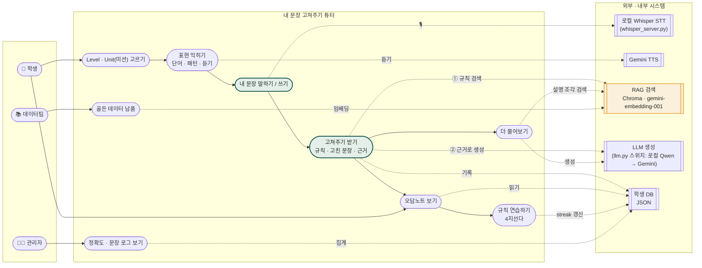
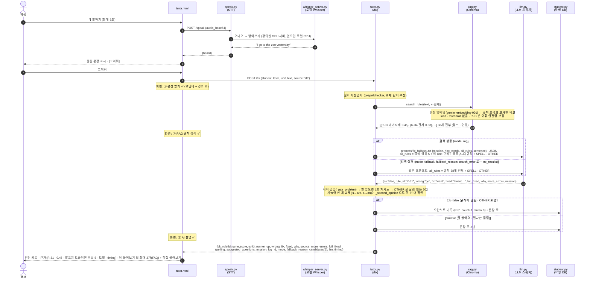
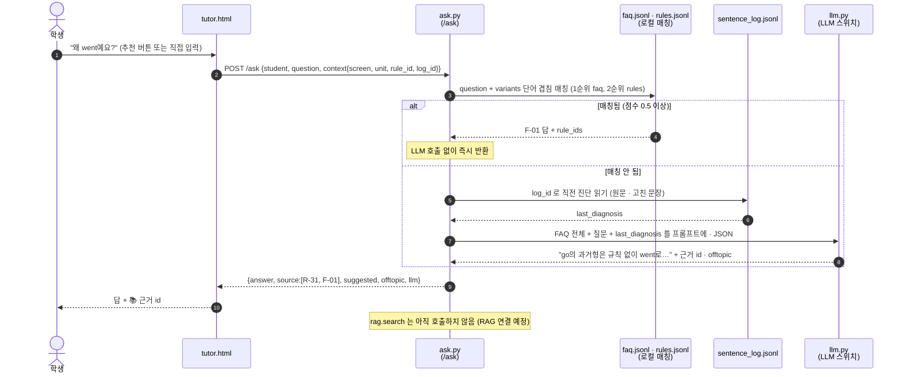
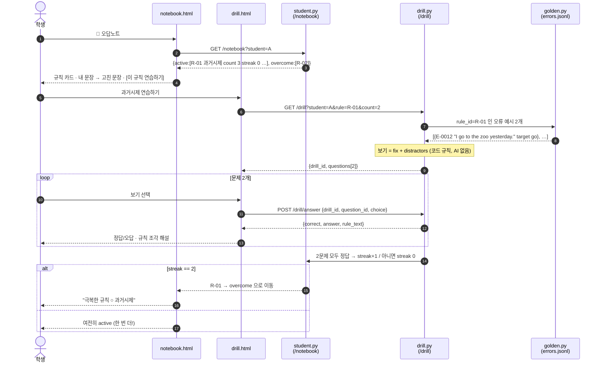
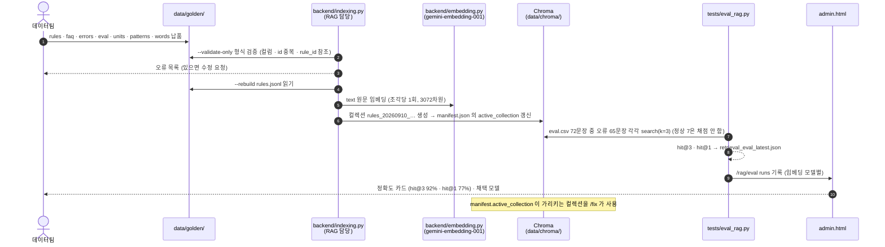
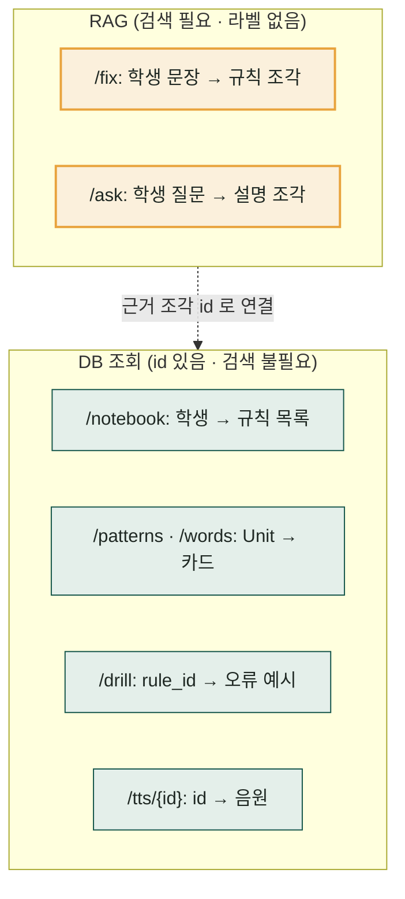

# 다이어그램 B — 유스케이스 · 시퀀스 (Mermaid)

작성 2026-09-06 · 근거: [PRD-B](PRD.md) · [mockup.html](mockup.html)
GitHub · VS Code(Mermaid 확장) · Notion 에서 그대로 렌더링됨.

---

## 1. 유스케이스 다이어그램

Mermaid에는 유스케이스 전용 문법이 없어 flowchart 로 표기 (타원 = 유스케이스, 사각 = 액터).

**포함 관계 요약**

| 유스케이스 | 액터 | 포함(include) | 확장(extend) |
|---|---|---|---|
| 고쳐주기 받기 | 학생 | 규칙 검색(RAG) · 근거로 생성(LLM) · 오답노트 기록 | 오류 없음 → "잘 썼어요" / 검색 실패 → 폴백(규칙 전부 참고) |
| 더 물어보기 | 학생 | FAQ 매칭 · 생성 (설명 조각 RAG 검색은 연결 예정) | 추천 질문 버튼 / 직접 입력 |
| 규칙 연습 | 학생 | 문제 꺼내기(DB) · 채점 · streak | 2회 연속 정답 → 극복 |
| 골든 데이터 납품 | 데이터팀 | 형식 검증 · 임베딩 · 임베딩 모델 비교 | |

---

## 2. 시퀀스 다이어그램 ① 고쳐주기 (핵심 · `/fix`)

---

## 3. 시퀀스 다이어그램 ② 더 물어보기 (`/ask`)

---

## 4. 시퀀스 다이어그램 ③ 오답노트 → 규칙 연습 → 극복

---

## 5. 시퀀스 다이어그램 ④ 골든 데이터 납품 → 인덱스 → 평가 (개발팀 내부)

---

## 6. 어디가 RAG인가 (한 장 요약)

