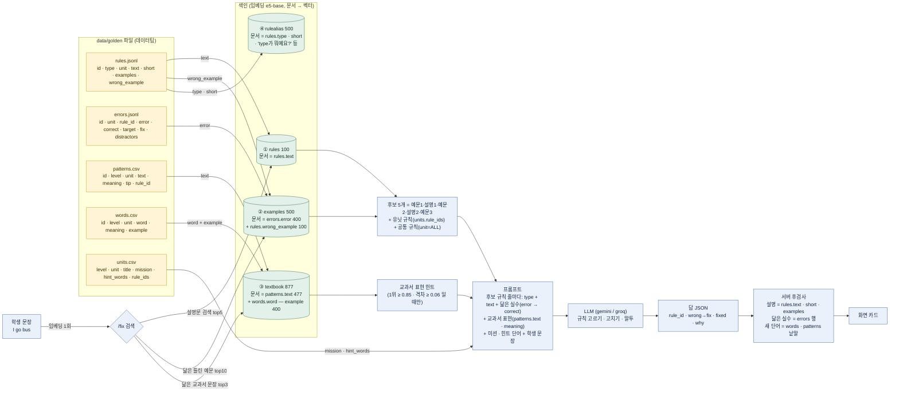
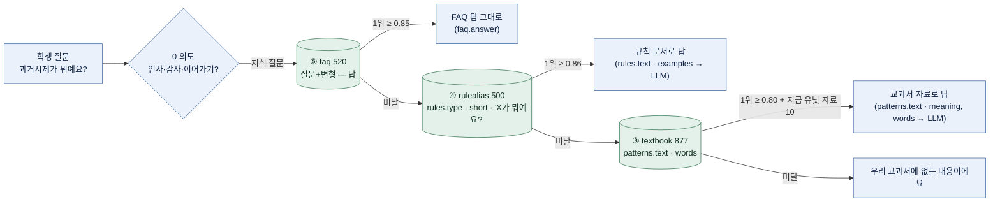

# 데이터팀용 — 우리 데이터가 어떻게 색인되고, 검색되고, 프롬프트에 들어가나 (2026-09-14)

데이터팀이 만드는 파일의 **어느 열이 어디에 쓰이는지**를 기준으로 그린 그림입니다. 기준 코드: 커밋 d7877da 이후 (`backend/textbook.py`, `backend/tutor.py`, `backend/indexing.py`).

## 1. 한 장 그림 — 파일의 열 → 색인 → /fix 검색 → 프롬프트



④ rulealias 는 /fix 가 아니라 /ask(챗봇)의 "과거시제가 뭐예요?" 같은 문법 용어 질문에 쓴다 (3절).

## 2. 열 하나하나 — 어디에 쓰이나

색인 = 벡터로 만들어 "닮은 것 찾기"에 쓰는 열. 프롬프트 = 모델에게 글로 보내는 열. 화면 = 서버가 답을 만든 뒤 아이에게 보여 주는 열. **안 씀** 표시는 지금 코드가 읽지 않는 열이니 정성을 덜 들여도 된다.

| 파일 | 열 | 색인 | 프롬프트 (/fix) | 화면·후검사 | 비고 |
|---|---|---|---|---|---|
| rules.jsonl | id | 키 | 후보 id | 규칙 칩 | 바꾸면 안 됨 (오답노트·로그·errors.rule_id 가 참조) |
| | type | ④ | 후보 줄 앞 | 규칙 이름 | 짧은 문법 이름 ("과거시제(시간)") |
| | unit | — | unit=ALL 이면 항상 후보에 추가 | — | 유닛 규칙은 units.rule_ids 로 |
| | text | ① | 후보 줄 본문 | "왜 그래요?" 설명 | **가장 중요.** 설명문 검색의 본문이자 아이가 읽는 설명. "틀린 예:" 문장까지 포함 |
| | short | ④ | — | 카드 한 줄 구호 | "한 명 This is, 여럿 These are" |
| | examples | — | — | 설명 예문 | 규칙 문서에서 답 재료 |
| | wrong_example | ② | — | — | 틀린 예문 색인에 error 와 함께 들어감 |
| errors.jsonl | id | 키 | — | 오답노트 연속 정답 기록 | 바꾸면 안 됨 |
| | rule_id | ② 메타 | 후보 규칙을 정하는 열쇠 | — | error 문장이 **그 규칙답게 틀린** 문장이어야 함 |
| | error | ② | "닮은 실수: {error}" | 🙋 타일 문장, 연습 문제 문장 | 검색 문서. 같은 틀 반복은 검색에 손해 |
| | correct | ② 메타 | "→ {correct}" | — | error 에서 target→fix 로 바꾼 것과 같아야 함 |
| | target | — | — | 밑줄, 연습 문제 | error 안에 그대로 있어야 함 |
| | fix | — | — | 연습 정답, 허용 목록 | 같은 종류 고침이 2행 이상이면 검증기가 허용 |
| | distractors | — | — | 연습 보기 3개 | 넣어서 맞는 문장이 되면 안 됨 |
| patterns.csv | text | ③ | 교과서 표현 힌트 (뚜렷할 때만) | 표현 익히기 · TTS · 📖 타일 | 아이가 따라 말하는 문장 |
| | meaning | ③ 메타 | 힌트 괄호 안 | 표현 익히기 뜻 | |
| | tip | ③ 메타 | — | 표현 익히기 💡 | rules.short 와 같은 말 |
| | rule_id | ③ 메타 | 힌트 패턴의 규칙이 후보에 없으면 추가 | — | 뚜렷할 때만 붙이고 애매하면 빈칸이 나음 |
| | level · unit | ③ 메타 | — | 학년 이하만 검색, 유닛 화면 | |
| words.csv | word | ③ | — | 단어 카드, "배운 말" 판정 | |
| | example | ③ | — | 단어 예문 TTS, "배운 말" 판정 | word 와 함께 한 문서 ("bus — I go by bus.") |
| | meaning | ③ 메타 | — | 단어 뜻 | |
| units.csv | mission · hint_words | — | "오늘의 미션" · "힌트 단어" | 미션 카드 | 프롬프트 5번 규칙(미션 확인) |
| | rule_ids | — | 유닛 규칙 = 항상 후보에 추가 | — | |
| faq.jsonl | question · variants · answer | ⑤ faq 520 ("질문 — 답") | (/ask) FAQ 답 그대로 | 챗 추천 칩 | /fix 에는 안 씀 |
| eval.csv | text · expected_rule_id | — | — | 관리자 평가 | 시험지. errors 와 같은 문장은 점수를 부풀림 |

## 3. /fix 가 실제로 하는 일 (순서)

1. 학생 문장을 임베딩 한 번.
2. ① 규칙 설명문 검색 top5, ② 틀린 예문 검색 top10(규칙별 1개), ③ 교과서 문장 검색 top3.
3. 후보 5개 = ②와 ①을 번갈아 합침(예문1·설명1·예문2·설명2·예문3, 같은 규칙은 한 번). 여기에 유닛 규칙(units.rule_ids)과 공통 규칙(rules.unit=ALL)을 더함. ③의 1위가 뚜렷하면 그 패턴의 rule_id 도 후보에.
4. 프롬프트: 후보 규칙마다 `[id] type: text · 닮은 실수: error → correct` 한 줄. 닮은 실수는 ②가 찾은 **그 규칙의** errors 행(없으면 생략). 교과서 표현은 ③이 뚜렷할 때만 `[p-id] text (meaning)`. 그리고 미션·힌트 단어·학생 문장.
5. 모델(gemini/groq)이 후보 안에서 규칙을 고르고 wrong→fix·고친 문장·why 를 JSON 으로.
6. 서버 후검사: 고침이 규칙에 맞는지(검증기), 설명은 모델 말 대신 rules.text·short·examples 로, 닮은 실수는 errors 행으로, 고친 문장의 새 단어는 words·patterns 낱말과 대조.

실제 프롬프트 후보 줄 예 (학생 "You close the door, please."):

```
- [R-45] 교실 명령문(Open/Close): 지시하거나 부탁할 때는 주어 없이 동사원형으로 시작해요. … 틀린 예: You open your book. · 닮은 실수: You close the window, please. → Close the window, please.
- [R-01] 형용사+be동사: 형용사 앞에는 반드시 be동사(am/is/are)가 와야 해요. … 틀린 예: I sorry. · 닮은 실수: I sorry. → I am sorry.
```

실측 (gemini, 120문장): 데이터 정비 뒤 검색 있음 81/100 · 검색 없음(규칙 100개 통째로) 89/100. 검색 있음이 틀린 19건 중 18건은 정답 규칙이 후보에 있었고 16건은 거의 같은 errors 문장이 검색 1위였는데 프롬프트에 안 보여 줘서 모델이 넘겼다 → 4번의 "닮은 실수" 줄을 추가함 (9/14 저녁, 재측정 중).

## 4. /ask (챗봇) 는 같은 색인을 이렇게 쓴다



FAQ 는 답을 그대로 돌려주는 빠른 길이고, 그 밖의 답은 전부 규칙·교과서 **문서**를 찾아 모델이 짓는다. 그래서 새 질문 유형이 안 잡힐 때는 FAQ 줄을 늘리기보다 "어느 문서에 답이 있는데 왜 못 찾았나"를 본다.

## 5. 데이터팀이 지켜 주면 바로 서비스에 들어가는 것

- **rules.text** 가 검색 본문이자 아이가 읽는 설명이다. "틀린 예: …" 문장을 꼭 넣고, 초등학생 말로.
- **errors.error** 는 그 rule_id 답게 틀린 문장. target 은 error 안에 그대로, error 에서 target→fix 하면 correct. 같은 종류 고침이 규칙당 2행 이상이면 검증기가 통과시킨다. distractors 3개는 넣어서 맞는 문장이 되면 안 된다.
- **patterns.text** 는 아이가 따라 말할 자연스러운 문장. rule_id 는 뚜렷할 때만.
- **words.example** 도 색인에 들어가고 "배운 말" 판정에 쓰이니 자연스러운 문장으로.
- id 는 바꾸지 않는다. 데이터를 바꾸면 색인은 개발팀이 다시 만든다(`python -m backend.textbook --rebuild`).

관련 문서: `docs/2026.09.14 검색 함수 계약 (textbook·examples·faq).md` (개발자용 함수 계약·실측), `docs/샘플데이터/2026.09.14 골든데이터 (data-golden 현재본, 패턴 재구성·규칙 분산).xlsx` (현재본·변경내역).
